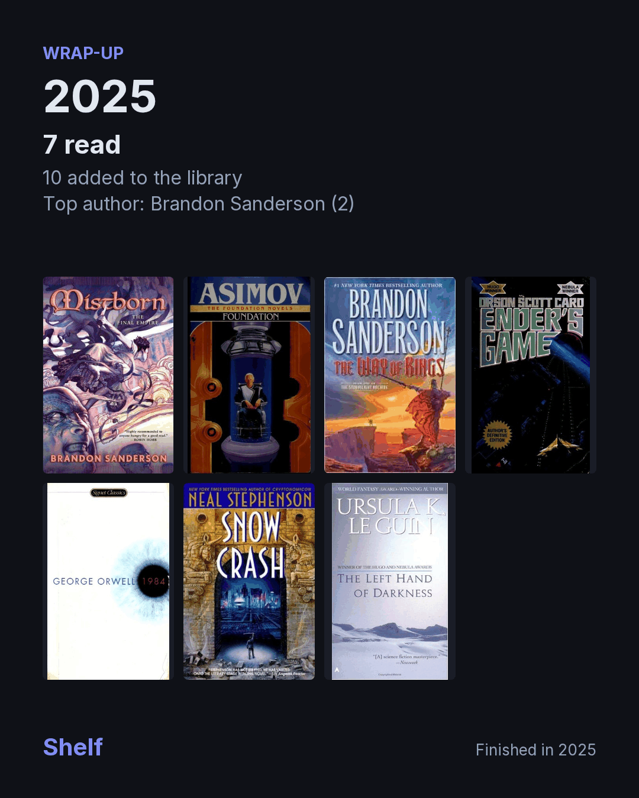

# Shelf

[](https://github.com/dgahagan/shelf/releases)
[](https://hub.docker.com/r/dangahagan/shelf)
[](https://github.com/sudo-rpaisley/shelf/actions/workflows/test.yml)
[](https://github.com/sudo-rpaisley/shelf/actions/workflows/test.yml)
[](https://github.com/sudo-rpaisley/shelf/actions/workflows/test.yml)
[](LICENSE)

Shelf is a self-hosted home library catalogue for books and other media. Scan
barcodes, photograph shelves, fetch metadata and cover art, track personal media
activity and lending, and organize libraries, locations, Collections and series
from a responsive web interface.

<p align="center">
  
</p>

> **Working fork:** this is [`sudo-rpaisley/shelf`](https://github.com/sudo-rpaisley/shelf),
> integrating [`dgahagan/shelf`](https://github.com/dgahagan/shelf). Release and
> Docker badges above refer to **upstream**, not a fork image. Recorded test-count
> badges are retained from the fork parent pending final collection; they are not
> evidence that this integration passed. See the [integration status and database
> compatibility contract](docs/upstream-integration.md) before trying the candidate.

## Highlights

- **Barcode scanning** — phone cameras and USB/Bluetooth scanners; ISBN, EAN,
  UPC and individual-copy labels. Nine workflows: Add, Shelf Fill, Wishlist,
  Lend, Return, Move, Inventory, Lookup and Quick Rate.
- **Photo Intake** — photograph a shelf or stack, review titles, authors, ISBNs
  and media types, then confirm. DVD/game rows use TMDb/IGDB on exact-title
  matches; vision can use Anthropic, an OpenAI-compatible endpoint or local Ollama.
- **Metadata and covers** — national bibliographies, Open Library, Hardcover,
  Google Books and media-specific providers; title search and Add by hand when
  a barcode cannot help. Cover search, upload, URL import and a review queue
  distinguish a provider failure from a genuine miss.
- **More than books** — audiobooks, eBooks, children's books, comics, Manga,
  magazines, DVDs/Blu-rays, vinyl, cassettes, CDs, digital music and games.
  MusicBrainz records exact music releases and tracks; periodicals have
  publication/issue identity. Related Media links formats and adaptations.
- **Libraries and personal activity** — library-specific Viewer/Editor access;
  private status, progress, history, rating, favourites, wishlist and notes.
  My List and Continue / Up Next span media without overwriting another user's
  state. The shared acquisition wishlist is a different list.
- **Collection organization** — Collections, multiple series memberships,
  provider-backed series metadata, gap checks, bulk issue ranges and release
  radar alongside tags, filters, bulk editing and customizable columns.
- **Physical inventory** — precise room/bookcase/shelf nodes, per-copy barcodes,
  condition, acquisition details, provenance and order; Shelf Fill, Arrange,
  printed labels and multi-device audits. Digital holdings stay separate.
- **Reversible deletion** — ordinary item/copy removal uses Trash, retaining
  children and history. The last live copy of an owned physical item cannot be
  removed. Restore needs library write authority; permanent purge is admin-only.
- **Lending and valuation** — checkouts, overdue reminders, statistics,
  insurance reports, optional ISBNdb price alerts and your own affiliate buy links.
- **Import/export** — CSV/TSV, Goodreads, StoryGraph, LibraryThing/Libib (beta)
  and Audible exports; portable catalogue archives with covers and database
  backup/restore. Personal-state privacy is not the same as shared catalogue export.
- **Store Mode** — offline ownership/acquisition-list checks and queued valid
  barcodes. Invalid codes are rejected without inserting placeholder items.
- **Optional features** — setup profiles and Settings → Features hide/refuse
  disabled workflows while retaining their data. Read-only API tokens support
  homelab dashboards without granting catalogue writes.

Shelf runs on your network in one container with SQLite; no Shelf-hosted account
is required. **Optional integrations do send data to providers:** identifiers,
search terms, selected photos, and reading activity when you enable sync. Remote
cover candidates also contact their image hosts. Use a local vision backend if
photos must stay local; self-hosting is not a promise of zero outbound traffic.

## Screenshots

| Browse | Scan |
|---|---|
|  |  |

| Item detail | Photo Intake |
|---|---|
|  |  |

| Series | Stats |
|---|---|
|  |  |

| Wrap-up |
|---|
|  |

Screenshots illustrate workflows; they are not browser-validation evidence for
the integrated candidate.

## Quick start

### Stable upstream image

To run **upstream**, not this fork, use its published image with a separate
data volume:

```yaml
services:
  shelf:
    image: dangahagan/shelf:latest
    container_name: shelf
    ports:
      - "18888:18888"
    environment:
      - CERT_SAN=${CERT_SAN:-DNS:shelf,DNS:localhost}
    volumes:
      - ./data:/data:z
    restart: unless-stopped
```

Save as `compose.yaml`, then run `docker compose up -d`. Open
`https://localhost:18888`, create the first admin account and choose a feature
profile. For another hostname/IP, set `CERT_SAN` in a local `.env`, for example
`CERT_SAN=IP:192.168.1.100,DNS:shelf,DNS:localhost`.

Browsers initially warn about the self-signed certificate. See
[HTTPS & reverse proxy](docs/https-and-reverse-proxy.md) for trusted certificates
and `SHELF_TLS=off` behind a TLS-terminating proxy. Set `SHELF_TRUST_PROXY` to
the proxy's actual IP/CIDR, not a blanket trust flag.

The official image and its release attestations are owned and published by
upstream. To verify an upstream release that carries an attestation:

```bash
gh attestation verify oci://index.docker.io/dangahagan/shelf:X.Y.Z --repo dgahagan/shelf
```

This fork does not publish that image or inherit its provenance guarantees.
See [Installation](docs/installation.md) for upstream tags and `docker run`.

### Run this fork from source

Read [database compatibility](docs/upstream-integration.md#database-compatibility)
first. Do not reuse an upstream/live data volume for a trial.

```bash
git clone https://github.com/sudo-rpaisley/shelf.git
cd shelf
docker compose up -d --build
```

The repository's Compose file builds local source, uses host networking,
defaults to `./data-dev` and listens on `https://localhost:18889`. Use disposable
data for evaluating the integration; these instructions are not a deployment
record or upgrade-safety claim.

## Persistent data

A normal container installation keeps state under `/data`:

```text
data/
  shelf.db        catalogue, users, settings, private activity and history
  covers/         cached cover images
  certs/          generated TLS certificate and key
  encryption.key  decrypts saved credentials unless supplied by environment
  signing.key     signs sessions unless SECRET_KEY is supplied
```

Back up a consistent whole directory or use the database backup tool. A whole
directory backup includes keys beside the data they protect: keep it private.
A database-only backup still contains private activity, password/token hashes
and encrypted credentials, and has no covers. A portable archive is a catalogue
transfer, **not** full recovery of every user's private state. See
[Upgrading & backups](docs/upgrading-and-backups.md).

## Documentation

Full documentation lives in [`docs/`](docs/README.md).

| Area | Documentation |
|---|---|
| Integration | [Status, compatibility and fork policies](docs/upstream-integration.md) |
| Operate | [Installation](docs/installation.md) · [Configuration](docs/configuration.md) · [HTTPS](docs/https-and-reverse-proxy.md) · [Backups](docs/upgrading-and-backups.md) |
| Use | [Getting started](docs/user-guide/getting-started.md) · [Home](docs/user-guide/home.md) · [Scanning](docs/user-guide/scanning.md) · [Browse](docs/user-guide/browse-and-search.md) · [Items](docs/user-guide/items.md) |
| Organize | [Locations](docs/user-guide/locations.md) · [Copies](docs/item-copies.md) · [Labels](docs/user-guide/labels.md) · [Audits](docs/user-guide/audits.md) · [Series](docs/user-guide/series.md) |
| Media | [Music](docs/user-guide/music.md) · [Periodicals](docs/user-guide/periodicals.md) · [Related Media](docs/related-media.md) |
| Workflows | [Photo Intake](docs/user-guide/photo-intake.md) · [Lending](docs/user-guide/lending.md) · [Wishlist & Store](docs/user-guide/wishlist-and-store-mode.md) · [Sharing](docs/user-guide/sharing.md) · [Import/export](docs/user-guide/import-and-export.md) |
| Administration | [Users & libraries](docs/user-guide/users-and-roles.md) · [Integrations](docs/user-guide/integrations.md) · [Homelab](docs/homelab-integration.md) · [Settings](docs/user-guide/settings.md) |
| Help/development | [Support](SUPPORT.md) · [Security](SECURITY.md) · [FAQ](docs/faq.md) · [Troubleshooting](docs/troubleshooting.md) · [Development](docs/development.md) · [Architecture](docs/architecture.md) · [Contributing](CONTRIBUTING.md) |

## Integrations

Core book cataloguing works without paid API keys. Optional services include
Hardcover, Audiobookshelf, Komga, RomM, IGDB, TMDb, MusicBrainz / Cover Art Archive,
ISSN Portal, ISBNdb, Google Books, LibraryThing, Discogs and vision backends.
Configured connectors preserve exact attached identities, rather than guessing
ownership from titles; provider-library IDs are separate from Shelf libraries.
See [Integrations](docs/user-guide/integrations.md) for setup and data use.

## Development

Python 3.12, FastAPI, raw SQLite (WAL), Jinja2, HTMX, Alpine's CSP build and
Tailwind CSS. JS/CSS is vendored; no CDN or inline-script dependency.

```bash
python -m venv .venv
source .venv/bin/activate
make setup
make dev
```

Common checks are `make test`, `make test-e2e` and `make checks`. Unit and E2E
suites run separately; live provider contract tests are outside normal gates.
These are contributor commands, not checks claimed to have run for this merge.

Fork CI is read-only. Generate and **commit** CSS/service-worker output with
`make css` and recorded suite counts with `make badges` in the same fork PR as
the source changes. Counts come from collection, not passing tests; do not
hand-edit them. There is no bot restamp/push-back or Docker publishing workflow.
See [Development](docs/development.md) and [Contributing](CONTRIBUTING.md).

## License

[AGPL-3.0](LICENSE) — free to use, self-host and modify. If you offer a modified
version as a network service, make the corresponding source available under
the same licence.
